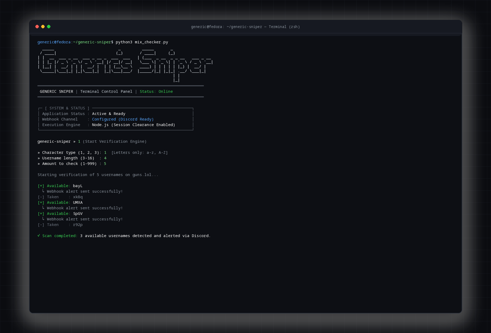

<div align="center">

```text
  _____                           _         _____       _                 
 / ____|                         (_)       / ____|     (_)                
| |  __  ___ _ __  ___ _ __ _  ___  ___   | (___  _ __  _ _ __   ___ _ __ 
| | |_ |/ _ \ '_ \/ _ \ '__| |/ __|/ __|   \___ \| '_ \| | '_ \ / _ \ '__|
| |__| |  __/ | | |  __/ |  | | (__\__ \   ____) | | | | | |_) |  __/ |   
 \_____|\___|_| |_|\___|_|  |_|\___|___/  |_____/|_| |_|_| .__/ \___|_|   
                                                         | |              
                                                         |_|              
```

### ⚡ Guns.lol Availability Engine & Terminal Control Center

*Motor de alta performance para verificação de disponibilidade de nomes na plataforma guns.lol com painel interativo no terminal e despachante de alertas em tempo real via Discord.*

<br/>

[](https://guns.lol)
[](https://nodejs.org)
[](https://python.org)
[](https://discord.com)
[](LICENSE)

</div>

---

## 📑 Visão Geral

O **Generic Sniper** é uma ferramenta desenvolvida com foco em velocidade, leveza e facilidade de uso para varredura e detecção de handles disponíveis na plataforma **guns.lol**. 

O projeto conta com arquitetura híbrida:
1. **Engine em Node.js (`checker.js`)**: Gerencia requisições assíncronas de alta performance, manipulação inteligente de cookies de sessão (`clearance`) e redirecionamentos transparentes (HTTP 307).
2. **Terminal Control Center em Python (`mix_checker.py`)**: Interface de terminal (TUI) rica e intuitiva para gerenciar execuções, configurar e testar webhooks do Discord sem precisar alterar arquivos de código.

---

## ✨ Recursos Principais

- ⚡ **Dual Engine:** Execute via Painel TUI interativo ou diretamente no terminal com o runtime do Node.js.
- 🍪 **Bypass de Sessão Inteligente:** Coleta automática de cookies e tratamento nativo de requisições `307 Temporary Redirect` das rotas de autenticação da plataforma.
- 📢 **Alertas Discord Monocromáticos:** Notificações em formato ASCII block minimalista enviadas instantaneamente ao seu canal do Discord quando um nome elegível for detectado.
- 🔠 **Matriz de Caracteres Customizável:**
  - Letras puras (`a-z`, `A-Z`)
  - Alfanumérico e sublinhado (`a-z`, `A-Z`, `0-9`, `_`)
  - Conjunto completo com hífens (`a-z`, `A-Z`, `0-9`, `_`, `-`)
- 📏 **Controle Total de Tamanho:** Filtre nomes entre 3 e 16 caracteres e defina o volume de varreduras (1 a 999 verificações por ciclo).
- 🪶 **Zero Dependências Pesadas:** Funciona usando 100% bibliotecas nativas do Node.js e da biblioteca padrão do Python 3. Sem `node_modules` gigantescos e sem pacotes pesados no `pip`.

---

## 🖥️ Demonstração Visual

<div align="center">
  
</div>

<br/>

### Notificação Discord (Embed Monocromático)
```text
╔══════════════════════════╗
║     USER DISCOVERED      ║
╠══════════════════════════╣
║  PLATFORM : guns.lol     ║
║  USER     : @generic     ║
║  STATUS   : AVAILABLE    ║
╚══════════════════════════╝
  generic sniper
```

---

## 🚀 Tutorial Completo de Instalação e Uso

### 1. Pré-requisitos

Certifique-se de possuir o **Git**, **Node.js** (versão 18 ou superior) e **Python** (versão 3.8 ou superior) instalados em seu sistema.

#### 🐧 Linux

* **Fedora / RHEL:**
  ```bash
  sudo dnf install -y git nodejs python3
  ```

* **Ubuntu / Debian:**
  ```bash
  sudo apt update && sudo apt install -y git nodejs npm python3
  ```

* **Arch Linux:**
  ```bash
  sudo pacman -S git nodejs python
  ```

#### 🪟 Windows

1. Baixe e instale o [Node.js](https://nodejs.org/) (versão LTS).
2. Baixe e instale o [Python 3](https://www.python.org/downloads/) (marque a opção **"Add Python to PATH"** durante a instalação).
3. Baixe e instale o [Git para Windows](https://git-scm.com/download/win).

*(Ou instale via terminal PowerShell com Winget:)*
```powershell
winget install OpenJS.NodeJS.LTS Python.Python.3 Git.Git
```

#### 🍎 macOS

Utilizando o [Homebrew](https://brew.sh):
```bash
brew install git node python3
```

---

### 2. Clonando o Repositório

Abra o seu terminal e clone este repositório:

```bash
git clone https://github.com/U4T3-BLNK/generic-sniper.git
cd generic-sniper
```

---

### 3. Configurando o Webhook do Discord (Opcional)

Você pode configurar a URL do seu Webhook de duas maneiras:

#### Método A: Pelo próprio Painel Interativo (Mais Fácil)
Ao iniciar o painel (`python3 mix_checker.py`), selecione a opção **`[2] Configure Discord Webhook`** e cole a sua URL. Em seguida, utilize a opção **`[3] Send Test Webhook Message`** para testar se a mensagem chega no seu servidor!

#### Método B: Via Variável de Ambiente (`.env`)
Copie o arquivo de exemplo e insira seu webhook:
```bash
cp .env.example .env
```
Edite o arquivo `.env`:
```ini
DISCORD_WEBHOOK_URL=https://discord.com/api/webhooks/SEU_ID/SEU_TOKEN
```

---

### 4. Como Executar

Você pode rodar o Generic Sniper em dois modos:

#### 🎮 Modo 1: Painel Interativo Completo (Recomendado)
```bash
python3 mix_checker.py
```
*OU:*
```bash
npm run panel
```
Neste modo, você gerencia a configuração do Webhook, executa testes de conexão e inicia as verificações com layout formatado.

---

#### ⚡ Modo 2: Execução Direta / Standalone (Node.js)
Se preferir rodar apenas o verificador diretamente via Node:
```bash
node checker.js
```
*OU:*
```bash
npm start
```
1. Escolha o tipo de caracteres (`1`, `2` ou `3`).
2. Digite a quantidade de caracteres para cada nome gerado (ex: `3` para nomes raros de 3 letras).
3. Digite o número de nomes que deseja verificar (ex: `100`).
4. Se não configurou o webhook antes, poderá informar a URL ou apertar **Enter** para ignorar.
5. O programa iniciará as checagens exibindo o status em tempo real no terminal (`[+] Available` ou `[-] Taken`).

---

## 📁 Estrutura do Projeto

```text
generic-sniper/
├── checker.js         # Motor assíncrono de checagem e disparo de webhooks (Node.js)
├── mix_checker.py     # Painel de controle TUI e gerenciador de conexões (Python)
├── package.json       # Metadados e scripts de execução NPM
├── requirements.txt   # Manifesto de dependências do Python (zero-dependency)
├── .env.example       # Modelo de variáveis de ambiente
├── .gitignore         # Regras de exclusão de artefatos temporários
├── LICENSE            # Licença MIT
└── README.md          # Documentação oficial e guia de instalação
```

---

## ⚖️ Aviso Legal & Uso Ético

> **Aviso:** Este projeto foi desenvolvido para fins educacionais e de estudo sobre automação web, manipulação de streams HTTP e interfaces de linha de comando. Certifique-se de utilizar a ferramenta de maneira responsável, respeitando as diretrizes de uso e limites de requisições da plataforma. Os autores não se responsabilizam pelo uso indevido deste software.

---

## 📜 Licença

Distribuído sob a licença **MIT**. Consulte o arquivo [LICENSE](LICENSE) para obter mais informações.

<div align="center">
  <sub>Construído com precisão minimalista por <a href="https://github.com/U4T3-BLNK">generic (U4T3-BLNK)</a>.</sub>
</div>
